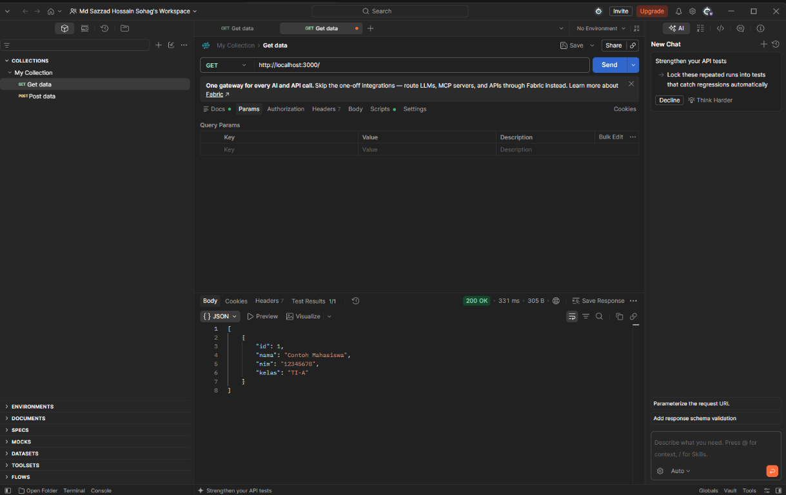

# Biodata CRUD API

An Express.js REST API for managing student biodata with PostgreSQL. The
application provides CRUD operations for the `biodata` table in the
`mahasiswa` database.

## Technologies

- Node.js
- Express.js
- PostgreSQL
- `pg` PostgreSQL client

## Prerequisites

- Node.js and npm
- PostgreSQL running on `localhost:5432`
- A PostgreSQL user with access to the `mahasiswa` database

## Database setup

Create the database, then run the schema script while connected to it:

```sql
CREATE DATABASE mahasiswa;
```

Run [`database.sql`](database.sql) in the `mahasiswa` database. It creates
the required `biodata` table with these columns:

| Column | Type | Constraint |
| --- | --- | --- |
| `id` | `SERIAL` | Primary key |
| `nama` | `VARCHAR(100)` | Not null |
| `nim` | `VARCHAR(30)` | Not null |
| `kelas` | `VARCHAR(50)` | Not null |

## Environment configuration

Set the PostgreSQL password in a local `.env`-compatible environment before
starting the server. The application reads `PG_PASSWORD` and never stores the
password in source control.

PowerShell:

```powershell
$env:PG_PASSWORD = "your-postgres-password"
```

The connection uses:

- User: `postgres`
- Host: `localhost`
- Database: `mahasiswa`
- Port: `5432`

## Installation and startup

```bash
npm install
npm start
```

The server listens on `http://localhost:3000`.

## API endpoints

| Method | Endpoint | Description | Success response |
| --- | --- | --- | --- |
| GET | `/` | Return all biodata records | `200 OK` |
| POST | `/biodata` | Create a biodata record | `201 Created` |
| PUT | `/biodata/:id` | Update a record by ID | `200 OK` |
| DELETE | `/biodata/:id` | Delete a record by ID | `200 OK` |

All SQL values supplied by requests use parameterized queries. Missing
records return `404 Not Found`, invalid required fields return `400 Bad
Request`, and database failures return `500 Internal Server Error`.

### POST body

`POST http://localhost:3000/biodata`

```json
{
  "nama": "Sazzad",
  "nim": "123456",
  "kelas": "TI-A"
}
```

### PUT body

`PUT http://localhost:3000/biodata/1`

```json
{
  "nama": "Nama Baru",
  "nim": "123456",
  "kelas": "TI-A"
}
```

## Testing with Postman

1. Start PostgreSQL and the API server.
2. Create a `GET` request for `http://localhost:3000/` and send it.
3. Create a `POST` request for `http://localhost:3000/biodata`.
   Select **Body > raw > JSON** and use the example body above.
4. Use the returned record ID in a `PUT` request to update the record.
5. Use the same ID in a `DELETE` request, then send `GET /` again to confirm
   that the record is absent.

## GET response screenshot

The following is a real Postman screenshot captured from the running local
API, showing the `GET http://localhost:3000/` response:



## Repository

https://github.com/sazconf/253_ServiceCRUD
