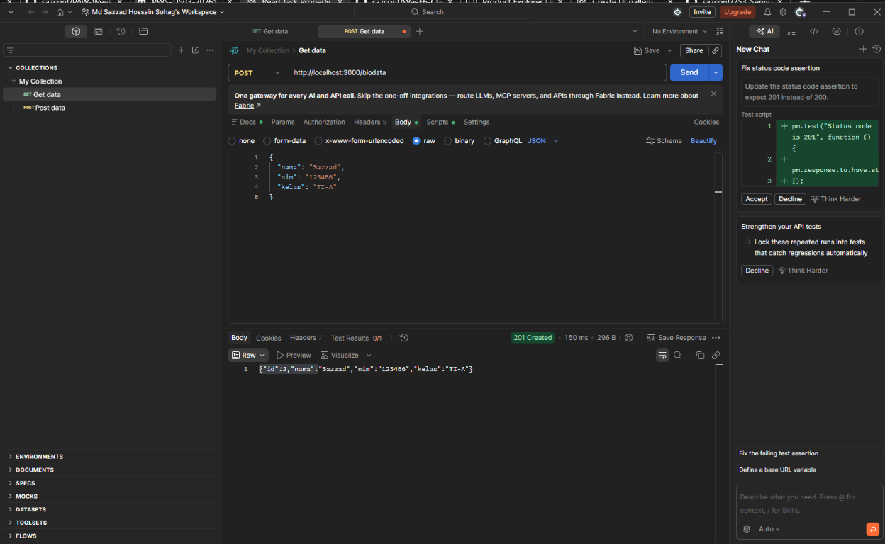
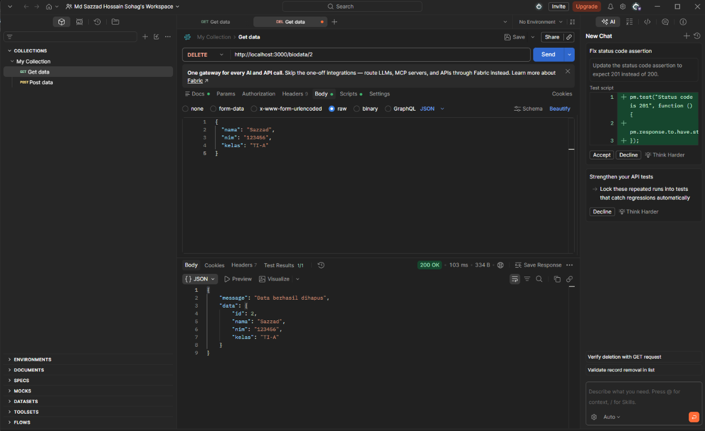
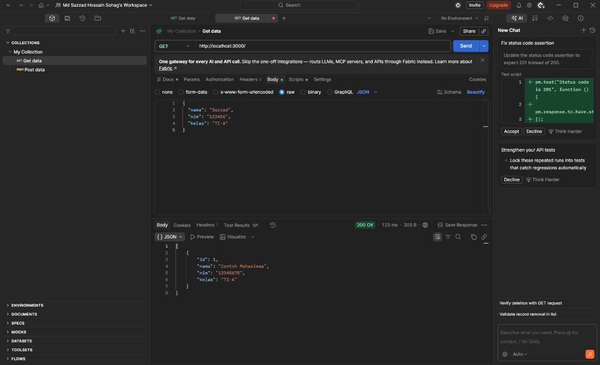

PRAKTIKUM 3 - EXPRESS + POSTGRESQL

1. Install PostgreSQL and remember the password for user postgres.
2. Create a database named: mahasiswa
3. In pgAdmin Query Tool while connected to mahasiswa, open/run database.sql.
   Alternatively, run the SQL in database.sql in your preferred PostgreSQL client.
4. Open this folder in VS Code.
5. Set PG_PASSWORD to your PostgreSQL password.
   If PG_PASSWORD is not set, the application uses the local default password 1234.
   Keep the password local; do not commit/share it.
6. Open the VS Code terminal in this folder and run:
       npm install
       npm start
7. Expected terminal message: App running on port 3000.
8. Test in Postman:
   GET    http://localhost:3000/
   POST   http://localhost:3000/biodata
          Body > raw > JSON: {"nama":"Sazzad","nim":"123456","kelas":"TI-A"}
   PUT    http://localhost:3000/biodata/1
          Body > raw > JSON: {"nama":"Nama Baru","nim":"123456","kelas":"TI-A"}
   DELETE http://localhost:3000/biodata/1

Important:
- package.json uses "type": "module" because index.js uses import syntax.
- Change the example ID in PUT/DELETE to an ID that exists in your table.
- The starter sample row may have ID 1 if the table was newly created.
- The API uses parameterized SQL queries for values supplied by requests.

API testing screenshots
-----------------------

### GET all biodata

### Create biodata

### Update biodata

### Delete biodata

### Request body example

